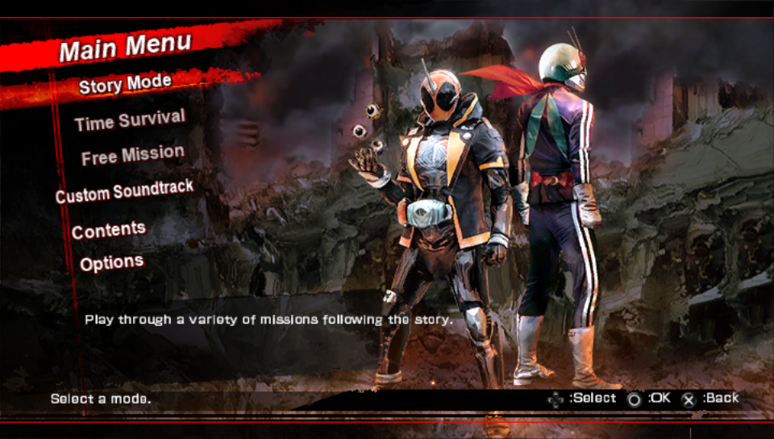
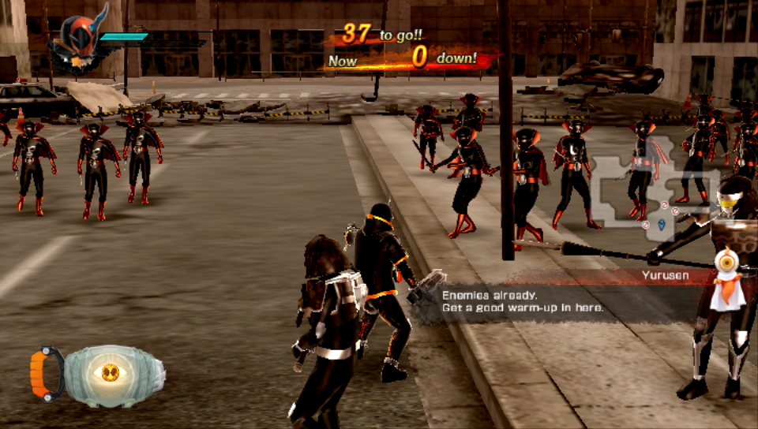
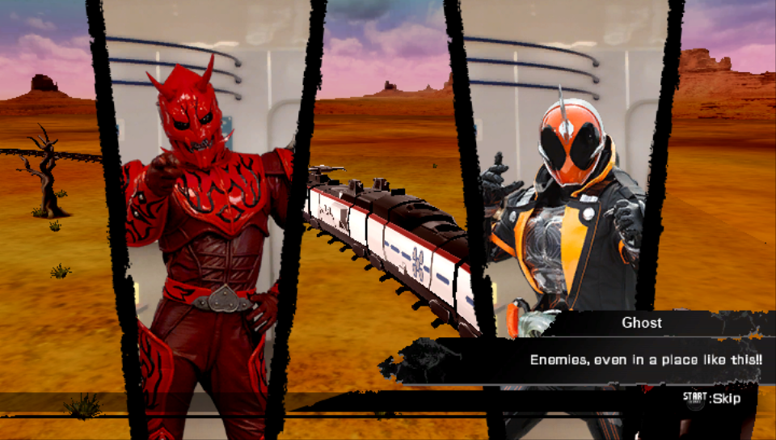
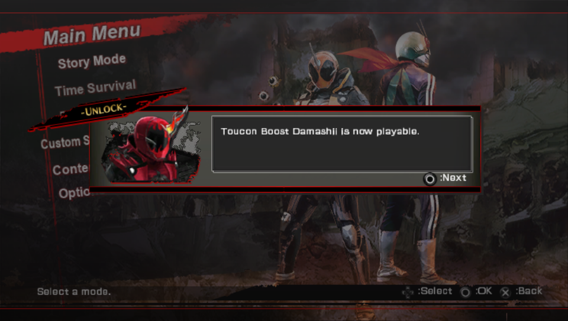
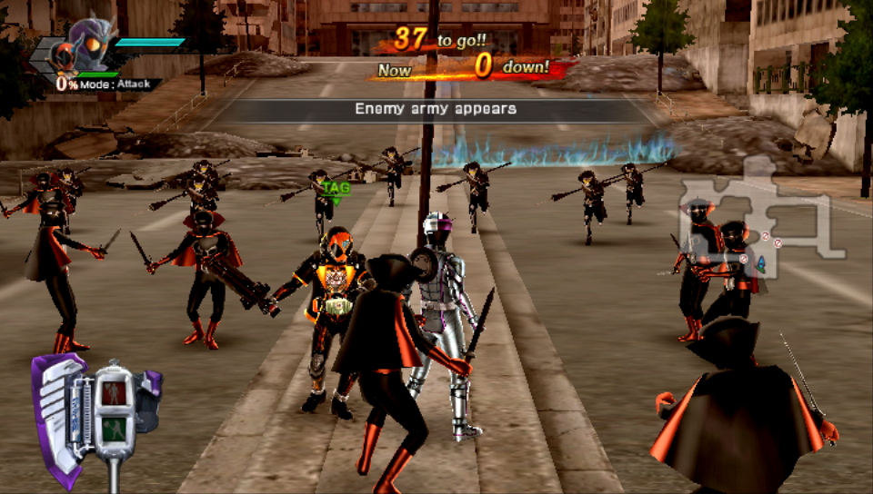
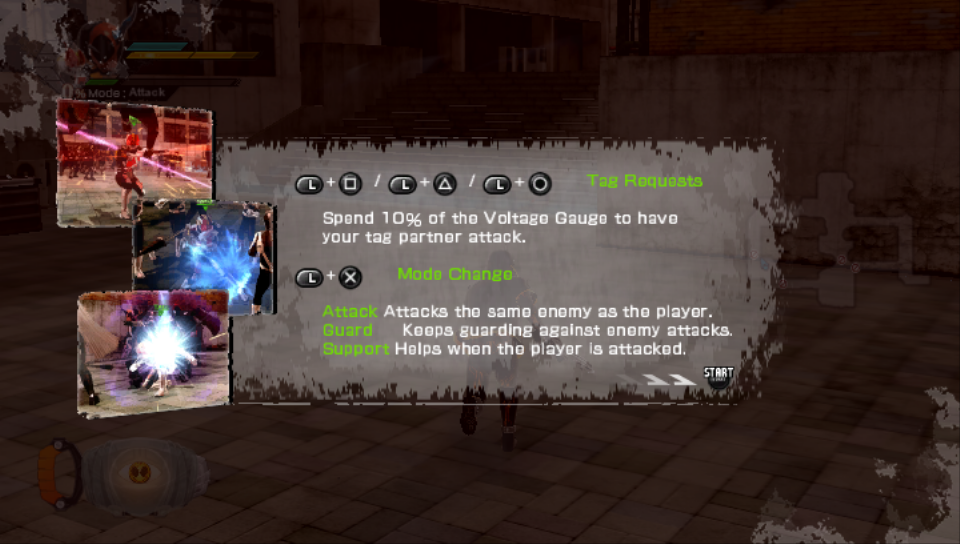
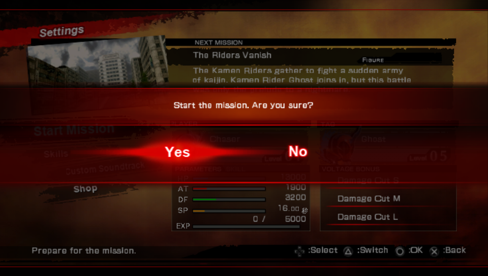
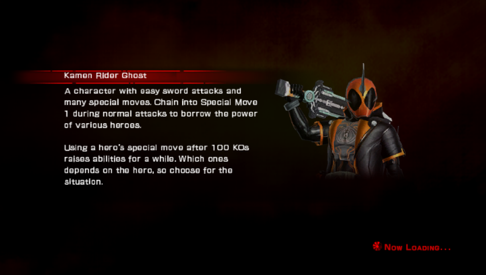

# Kamen Rider: Battride War Sousei (PS Vita) — English Patch

A fan English translation patch for **仮面ライダー バトライド・ウォー 創生** (*Kamen Rider: Battride War Sousei* /
*Genesis*, PS Vita, Japan only, `PCSG00675`).

There is no official English release of this game on any platform, so everything is a new translation. Rider,
form and finisher names follow the official English of *Kamen Rider: Climax Fighters* where possible.

> **Status: v0.1.2, first full translation pass.** Text, menus, story, mission dialogue, battle lines, UI images
> and movie subtitles are in English. Tested on a real PS Vita; some text may still overflow its box.
>
> **Patch it in your browser with the [web patcher](https://irxd.github.io/battride-vita-en/)** or download the
> patch files from the [Releases](https://github.com/irxd/battride-vita-en/releases) page. See [Install](#install).

<p align="center"> </p>

More screenshots: [Screenshots](#screenshots).

## What's translated

- **Text:** all menus, help, tips, tutorials, shop, figures, skills, special moves, character and figure
  descriptions, story mode, mission briefings and objectives, mission dialogue, battle lines and navigator
  commentary (about 9,200 unique lines).
- **Font:** the game's own font, with narrower Latin letters and spacing so English fits.
- **UI images:** boot notice, Yes/No buttons, main menu, screen headers, options, pause and customize menus,
  all 54 mission objective banners, battle HUD labels (Defeated!, Clear!, counters, mission gauges), 61 rider
  name plates, ranking record labels.
- **Not translated:** staff names in the credits, some very small labels in a few screens, stylised kanji that are
  part of finisher effects, and the game's name on the home screen (optional fix below).

## Install

You patch files from **your own copy** of the game. No game data is included.

### What you need

- **The game:** PCSG00675 with the **1.02 update** installed (`ux0:patch/PCSG00675/` exists). The patch is made
  for the 1.02 files.
- **On the Vita:** HENkaku/Ensō, the **rePatch** plugin and **VitaShell**. Recommended: **FAGDec**, for the
  game program (the result screen and some messages are built into it).
- **On the PC:** Chrome or Edge for the [web patcher](https://irxd.github.io/battride-vita-en/), or Python for the
  [manual install](#manual-install).

DLC needs nothing: the DLC only unlocks characters that are already in the 1.02 update, and they use the
patched files too.

### Real PS Vita

**1. Copy the decrypted game files to your PC (VitaShell, over FTP)**

1. In VitaShell go to `ux0:app/PCSG00675/`, press △ and choose **Open decrypted**.
2. Press SELECT to start FTP, and copy the `nativeVITA` folder to a PC folder, e.g. `game/`.
3. Do the same for `ux0:patch/PCSG00675/` (the update): **Open decrypted**, copy its `nativeVITA` folder to
   another PC folder, e.g. `update/`.

USB mode gives the still-encrypted files, so use FTP (or copy the folders to another place on the Vita with
VitaShell first, then over USB).

**Recommended: the game program (eboot) with FAGDec.** Some text (result screen labels, the "Play this mission?"
question, save and DLC messages) is built into the game program, not the data files. Without this step that text
stays Japanese; everything else is still patched.

1. Open FAGDec, select the game and press ✕.
2. Select the **update** eboot, `ux0:patch/PCSG00675/eboot.bin`, and press ✕.
3. Copy the `eboot.bin.elf` it made (in `ux0:FAGDec/patch/PCSG00675/`) to your PC.

**2. Patch**

1. Open the **[web patcher](https://irxd.github.io/battride-vita-en/)** in Chrome or Edge.
2. Choose the game folder under **Game folder** and the update folder under **Update 1.02 folder**. Only the
   files the patch needs are checked; the rest are skipped. If you made `eboot.bin.elf`, choose it under
   **Game program (eboot)**.
3. Press **Patch**. You get a `rePatch` folder (or a zip with it). Nothing is uploaded.

**3. Copy to the Vita**

Copy the `rePatch` folder to `ux0:` so the files end up in `ux0:rePatch/PCSG00675/`. Start the game.
Your files in `ux0:app` and `ux0:patch` are not changed.

**4. Optional: English game name on the home screen**

1. Don't install or delete apps on the Vita until you've finished these steps.
2. With VitaShell, copy `ur0:shell/db/app.db` to your PC. Keep this file as a backup.
3. In the web patcher, choose it under **Optional: English game name**. It saves a new `app.db`.
4. Copy the new `app.db` to `ur0:shell/db/app.db`, replacing it, and restart the Vita.

(Without the web patcher: `python tools/rename_title.py app.db`, from the release zip.)

### Manual install

1. Download `battride-war-genesis-en-<version>.zip` from
   [Releases](https://github.com/irxd/battride-vita-en/releases) and unzip it.
2. Install [Python](https://www.python.org/downloads/) 3.8 or newer.
3. In the unzipped folder, run (with your own paths from step 1 above):

   ```
   python tools\apply_patches.py "C:\path\to\game" "C:\path\to\update" "C:\path\to\eboot.bin.elf" --out out
   ```

   Leave out the `eboot.bin.elf` path if you don't have it.

   It finds each file by its path and checksum, patches it, and writes `out\rePatch\PCSG00675\...`.
   No other tools are needed (the xdelta patches are applied by the script itself; `xdelta3 -d` works too).
4. Copy `out\rePatch` to `ux0:` on the Vita.

### Updating to a new patch version

Patch your **original** files again and replace the files in `ux0:rePatch/PCSG00675/`.

### Removing the patch

Delete `ux0:rePatch/PCSG00675/` (this also removes the patched `eboot.bin`). If you changed `app.db`, copy your backup back
to `ur0:shell/db/app.db` and restart the Vita.

## Known issues

- First translation pass: some lines may overflow their text box. Please report them with a screenshot.
- Some tiny labels (record screen, portrait name tags) are still Japanese.
- Without the FAGDec `eboot.bin.elf`, the result screen and some messages stay Japanese.
- Credits staff names are left in Japanese.
- Made for a real PS Vita only. Emulators are not supported.

## Screenshots

Taken on a real PS Vita (game version 1.02).

<table>
<tr><td><br><sub>Main menu</sub></td><td><br><sub>Story scene</sub></td><td><br><sub>Unlock message</sub></td></tr>
<tr><td><br><sub>Battle dialogue</sub></td><td><br><sub>Battle objective and kill counter</sub></td><td><br><sub>Tutorial</sub></td></tr>
<tr><td><br><sub>Mission settings and confirmation</sub></td><td><br><sub>Character description while loading</sub></td><td></td></tr>
</table>

---

# For developers

## No game data here

The repository holds only tools, scripts and translations. `.gitignore` is an allow-list, and `dump/`,
`decrypted/`, `build/` and `release/` stay local. Translation files (`text/string/*.json`) contain no Japanese
game text: each key is the first 10 hex digits of the SHA-1 of the Japanese line, each value is the English.
The release contains only xdelta patches.

## Building

See [CLAUDE.md](CLAUDE.md) for the local data layout and [PLAN.md](PLAN.md) for the formats and status.

```
python -P -X utf8 tools/build_text.py build     # text + font  -> build/rePatch/PCSG00675
python -P tools/build_images.py                  # UI textures  -> build/rePatch/PCSG00675
python -P tools/build_eboot.py                   # eboot text (text/eboot.json) -> build/.../eboot.bin
python -P scripts/make_release.py 0.1.2          # both, then xdelta patches -> release/ and docs/patcher/patches/
```

`make_release.py` needs `xdelta3` and the decrypted game (`scripts/decrypt_vita.ps1`). It makes one patch per
changed file against the 1.02 original (`decrypted/patch` first, then `decrypted/app`), checks that each patch
recreates the file exactly, and writes `manifest.json` (source path, size, SHA-1 → target path, size, SHA-1) for
the web patcher and `apply_patches.py`. It also writes a `-rePatch-LOCAL-ONLY.zip` of the patched files for your
own testing: it contains game data, so never publish it.

The web patcher (`docs/`) runs entirely in the browser: `patcher/vcdiff.js` applies the xdelta (VCDIFF) patches,
`patcher/zip.js` writes the zip, `patcher/title.js` edits `app.db` / `param.sfo`. To publish it, commit
`docs/patcher/patches/` from a release build (it is git-ignored, so `git add -f`) and serve `docs/` with GitHub
Pages.

## Credits

- Translation and tools: this project
- Official English names: *Kamen Rider: Climax Fighters* (Bandai Namco, PS4, Asia English)
- Tools used: VitaShell, rePatch, psvpfsparser, xdelta3, capstone, keystone, unicorn, Pillow
- Release pipeline and web patcher adapted from the author's
  [Shin Gundam Musou English patch](https://github.com/irxd/shin-gundam-musou-en)

This is an unofficial fan project and is not affiliated with Bandai Namco, Eighting, Toei or Ishimori Productions.

## License

The code in this repository (tools and scripts) is released under the [MIT License](LICENSE).

The license does not cover the game or anything taken from it. *Kamen Rider: Battride War Sousei*, including its
text, graphics and code, belongs to its owners (©石森プロ・東映, Bandai Namco Entertainment). The release patches
are meant only for use with a copy of the game you own.
